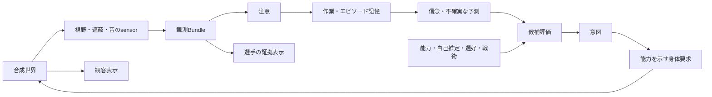

# 研究アーキテクチャ

[English](ARCHITECTURE.md) | [日本語](ARCHITECTURE.ja.md)

[ADR-002](decisions/ADR-002-research-boundaries.ja.md)がディレクトリ責務、依存方向、互換性、公開境界を定めます。[動的場面](../tools/workbench/docs/DYNAMIC_SCENES.ja.md)は一人の制御選手と指定刺激、任意のv3自律選手を扱います。

独立した成果物は研究文脈を共有しますが、採否を共有しません。

- **選手モデル**：決定論的な実行prototype。`think(Bundle, Memory, Profile, RulesA)` は検証した観測境界から、確認できるtraceと対応能力を明示した身体要求を返します。
- **判断原則**：[RUGBY_JUDGMENT](../models/judgment/RUGBY_JUDGMENT.ja.md)は条件、基準、優先度、例外、不明、根拠を持つ独立文書です。任意の一般AIがrunnerなしで使え、ローカル承認済み追加原則を完全なMarkdownへ出力します。

## packageと交換契約

`models/player` は単独実行可能な純粋認知、`tools/simulation` は世界・知覚・身体、`tools/experiments` はsnapshot・case・比較・提案交換、`tools/workbench` はUI・描画・CLI・私的保存を所有します。rootの互換exportは残します。`check:boundaries` が公開APIと意味上のengine source依存を検査します。

Scene v1の旧thinkは維持します。実行契約v2はlegacyまたは任意の [H-WM-1](../models/player/spec/H-WM-1.ja.md) を選択します。旧workingMemoryは表示抜粋で、研究機構は符号化・取得・順位・受け手候補・除外理由を別記します。全保持証拠を危険・定位・新鮮さ判定に使い、有限対無制限は容量介入、legacy対無制限はpolicy比較です。

[初回手順](../tools/workbench/docs/FIRST_RUN.ja.md)の版付き共有提案は不活性なデータです。manifestは許諾された合成entryと完全な固定参照を列挙し、raw JSON検証は復号後に重複するkeyもparse前に拒否します。importは承認を継承せず、再現は新しいローカルrunとsemantic digestを作り、成果物別のbefore/afterを確認します。正確なengineがなければ選手モデル実行を止めても文書描画は独立します。文書baselineと順序付き追加原則はundo・再起動を越えて版管理し、evidence graphは仮説、反例、run、review、artifact参照、撤回を保持します。

新sessionは外側format 2です。format 1の読取は記録/hashを変更せず、コピーまたは許諾sessionの初回成功書込で外側formatと要求変更だけを更新します。[本物の旧合成fixture](../evaluation/baselines/LEGACY_SESSION.ja.md)で検査します。旧readerはformat 2を拒否します。新engineは明示した意味上のソースと依存lockの `source-manifest-v1` を使い、旧digestの意味を維持します。以下の旧動作説明は古いbinaryが新形式を扱うという主張ではありません。

## 情報境界

世界から観測を構築するのは `sense` / `senseActor` だけです。`src/cognition.ts` は互換exportで、`models/player/reference/src/` はworld/simulation/rendererへの推移依存を持ちません。JSON Schemaは未知fieldを拒否します。視覚は見える位置、音は粗い身体相対方向とcueで、真の音源位置・ID・意図を渡しません。v1/v2の自己位置・身体・首・保持は正確な合成固有感覚という仮定です。

Snapshotは再現・観客用に世界真値を含む**研究包絡**です。選手モデルへ渡すのはbundle、memoryBefore、profile、rulesAだけです。`bridge context` はworldを除外します。完全snapshotを選手役AIへ渡しません。遮蔽・背後の真値だけを変えた試験ではtrace全体の一致を要求します。

## 旧認知と根拠

| 段階 | 旧prototype | 状態 |
|---|---|---|
| 感覚 | 水平90°、35m、2D円形遮蔽、20m以内の声 | 網膜・音響ではなく工学的仮定 |
| 注意 | call、球、選手の順に最大4件 | 人間測定ではないheuristic |
| 作業記憶表示 | 判断後に最大4信念を抜粋。他の保持信念も判断へ作用 | 容量ボトルネックではない |
| エピソード | 128件、30秒、snapshotで再起動後も保存 | 生物学的長期記憶の主張ではない |
| 意味知識 | 承認済みルール設定、独立した判断文書 | 文章から自動規則抽出しない |
| 信念 | entity/modalityごとの最新、元時刻・確信度維持、派生減衰 | 半減期は実験パラメータ |
| 予測 | 最終観測位置と拡大する不確実性、旧版は速度推定なし | 隠れた未来を使わない |
| 評価 | 資格、危険・情報、選好・自己推定、戦術混合。音で首方向を選択 | 未較正heuristic |
| 意図・身体 | scan/hold/carry/pass/support、移動・首、意味的call | 旧passは意図のみ。音声・筋肉・姿勢・眼球は非対応 |

[Baddeley 2012](https://www.annualreviews.org/content/journals/10.1146/annurev-psych-120710-100422)は機能分離の概念的動機で、容量・減衰・ranking・身体・競技結果・脳との同等性の根拠ではありません。

`Profile.ability` は速度・距離、`selfEstimate` はパス信頼性の自己認識、`preference` は選好、`tactics.adherence` は個人得点とチーム行為の混合です。戦術で禁止パスや未対応技能を可能にしません。新出力はBodyCommandと能力報告を拡張し、rendererやP2P型へ認知を埋めません。

cognition-0.2では古い相手の不確実円と4m近傍の重なりを減衰確信度で重み付け、carry/supportの得点・速度を下げ再観測価値を高めます。記憶の選手は方向付き情報要求、support/warning-callは重み付きcueと元observer yawから不確実な首方向を作ります。音源位置・IDを推定せず、パス資格には新しい受け手観測が必要です。traceは値と根拠sourceを示し、paired testは現在視覚/profileを固定して記憶・音の有無/意味/方向だけを変えます。

## 研究トランザクション

1. scene/seed/time/player/body/観測/記憶/profileと成果物別版を固定します。
2. 原文指導を空の実行patchと未完成の文書欄を持つ候補へ保存します。ルールは変わりません。
3. 人とCodexが数値・観測条件patchと独立原則、理由・予測・反例を編集します。採用にはならず、一方でもreview後は不変です。理由付きreviseは同じ観測と現在baseを持つ子候補です。
4. 保存baseへのpreviewは状態を変えず、active比較と区別します。層別試験と文書の独立reviewを行います。
5. 本人が成果物別に採用・却下・理由付き差戻しを行います。確認revisionをlock内で比較し、409では再読取・再確認します。receiptは版・内容を固定。空patch、TODO文書、古いbaseは採用を拒否します。本人操作は自己申告で暗号認証ではありません。
6. undoもlock内で確認active版を照合し、その対象だけを戻します。版・eventは保持し、approvedは過去の承認を意味します。

ドラフト0.1は全区間、到達順序、依頼意図、データ/描画別reviewを追加しました。私的出力は凍結初期原本と承認済み追加原則のままで、repo編集は置換しません。パラメータ比較の両側は現在engineで実行し、旧binaryを復元しません。

JSON状態は単一writerのdirectory lock下でatomicに保存し、検証失敗でactiveを変えません。UI/CLIは同じstoreで、AI送信はありません。loopback、Host、Origin、ローカルJSON headerを検査しますが、多人数認証や同じlocal userのコードへの防御ではありません。

## 条件付き実験

cognition-0.3は最大32一意IDの `contextRules` を追加します。保持・証拠・近い脅威はbundle/belief由来で、得点を戦術混合前に変えても資格を覆しません。scene/seed/隠れたIDを条件にしません。選ばれた行為の一致規則は意味的callを発し、有界履歴と同cue cooldownを持ちます。音声・他者反応・自己への新聴覚にはなりません。

`run` は同じ初期条件から記録場面と固定8層の1–20stepを保存します。行動差で後の観測は分岐し得ます。候補revision/notes、入力、両ルール、両文書/追加原則、trace、engine識別、runtime/Git/dirty、lock/snapshot/result/document hashを固定し、Git不明はnullです。新ソースでの記録前にserverを再起動します。保存結果は再計算せず、旧実行には旧ソースが必要です。

回帰は候補profileを保持し、事前凍結条件は指導前のcriteria/profile/digestと最初・再使用を区別します。文書packetは一群と匿名観測/profile/memoryだけで、状況名、scene/seed、採点、world、実行結果、実験IDは評価側へ分離します。別の新会話で各armを評価し、回答を群・case集合・input hashへ結びますが未検証です。bridgeはAIを呼ばずpreview原則は未採用と明示します。[研究loop](../tools/workbench/docs/RESEARCH_LOOP.ja.md)を参照してください。

UIは順序付きhead/body観測と時刻/profile/設定を保存し、worldを再参照せず再生します。停止中の回転は同時刻・別sequence、stepだけが0.2秒進みます。固定観測比較と行動による閉ループを区別します。[評価手順](../evaluation/PROTOCOL.ja.md)が手動介入と限界を定義します。

## 拡張範囲

[JSON Schema](../models/player/spec/contracts.schema.json)は言語非依存で、単位はm/rad/s、合成攻撃方向は+zです。Python/RustもThreeなしで観測契約を使えます。描画adapter内にbyte保存したP2P手続きmodelと最小ContactPoseだけを置き、compiler/core/BoardDocument/Auth/Blob/GLB/外部素材は含めません。カメラは身体位置・目高・首/身体yawを使い、P2P boneや世界球追跡は使いません。一人称の自己meshを隠し、停止時は必要時描画、disposeでtexture/material/geometry/skeleton/WebGLを解放します。形状は新技能を追加しません。

## 新しい版の契約

[認知研究契約](COGNITIVE_RESEARCH.ja.md)は機構仮説・ソフトウェア・人間検証を区別します。[表示接続](../tools/workbench/docs/PRESENTATION.ja.md)は会話を実表示captureへ結び、命令は一時的で採否を行いません。contextは観測だけです。

[方向・局面](../models/player/spec/ORIENTATION_PHASE.ja.md)はScene 2→Bundle 2→Trace 3。可視の向き・保持cueをsensor whitelist、注意、不変記憶経由で推定し、既知の攻撃方向は事前文脈です。v2守備/不明はscan/hold、旧入力は維持します。hashはsituation/schema/replayを含み、共有提案も観測だけで再現できます。

[閉ループ](../models/player/spec/CLOSED_LOOP.ja.md)はScene 3→Bundle 3→Trace 4。純粋認知が観測運動推定・意図保持、simulationが制約運動・球・同期actor、experimentsが固定frame・6arm除去・評価専用指標、workbenchが永続receiptとsnapshot/candidate参照を所有します。新しい最上位アプリやAI APIは追加しません。

成功したcapture/present/returnと比較frame参照はstate.jsonへ保存し、要求は再起動後再実行しません。snapshotとreceiptは別lock transactionで、前者だけ残る中断があり得ます。receiptは人間の閲覧・承認の証明ではありません。research-logは採否を変えず来歴を表示します。

## 観測の継続保存

API 11は256件上限前に取得観測を保存し、同じ世界・時刻・認知で続けます。最後の一件を重ねて元memory-beforeから再生し、時刻・確信度を更新しません。snapshot限定のobservationPredecessorが親ID/hash、評価専用observationAnchorが区間開始worldを固定します。どちらも隠れた真値を認知へ送らず、storeは親境界を検証します。要求IDで中断再送を冪等化し、旧bytesを維持します。現在区間と過去保存区間を区別し、長い履歴を新生成経路で黙って置換しません。
