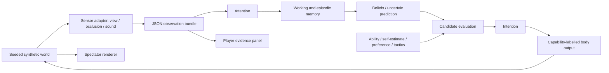

# Research architecture

Two independent deliverables share research context, not an approval switch:

- **A** is a deterministic executable prototype. The `think(Bundle, Memory, Profile, RulesA)` function accepts a validated observation boundary and returns an inspectable trace and capability-labelled body requests.
- **B** is [RUGBY_JUDGMENT.md](../RUGBY_JUDGMENT.md), a standalone principle system with conditions, criteria, priorities, exceptions, uncertainty and evidence. Any general-purpose AI can use it without A. Its local approved amendments are exported into a complete Markdown document.

## Data boundaries

Only `src/simulation.ts::sense` reads simulation truth to construct observations. `src/cognition.ts` imports contracts and validation, never the world/simulation/renderer. JSON Schema rejects unknown fields; an opponent's internal state cannot enter through extra properties. Vision gives currently visible positions; audio gives a coarse body-relative bearing and a cue, not a source's exact coordinates, identity or intent. Own position, heading, head angle and ball possession are synthetic proprioceptive inputs, explicitly assumed accurate in v1.

`Snapshot` is a **research envelope** and deliberately contains world truth for reproduction/spectator use. A receives only `snapshot.bundle`, `memoryBefore`, `profile` and `rulesA`. `bridge context` omits the world, while the private snapshot remains available for explicit experimental inspection. Do not give the full world envelope to an AI asked to reason from the player's perspective. Tests alter occluded or behind-player state and require complete A traces to remain identical.

## Cognition and evidence status

| Stage | Prototype behavior | Status |
| --- | --- | --- |
| Sensation | 90° horizontal cone, 35m range, 2D circular occlusion; calls within 20m | Engineering assumptions; no retinal/acoustic model |
| Attention | At most 4 percepts; calls, ball, then players | Explicit heuristic, not measured human attention |
| Working memory | At most 4 currently usable beliefs | Engineering capacity; not a universal human constant |
| Long-term/episodic store | Bounded 128 observation episodes, 30s simulation window; snapshot persists across process restart | Infrastructure for a later long-term model; 30s is not a biological LTM claim |
| Semantic knowledge | Approved A rule configuration supplied separately; B is independently authored | No automatic extraction from text into A |
| Belief | Latest per entity/modality, original `observedAt` and `confidence`; derived confidence decays by age | Exponential half-life is an experiment parameter |
| Prediction | Last observed position with growing uncertainty; no velocity inference; uncertainty overlap contributes to risk | Conservative engineering hypothesis; no hidden future state |
| Evaluation | Hard eligibility, risk/information assessment, then weighted preference/self-estimate and team adherence; heard direction can select head yaw | Inspectable heuristic; not fitted behavior |
| Intention/body | Scan, hold, carry, pass, support; supported kinematic translation and head yaw | Pass remains intention-only; semantic call events supported; acoustic voice, joints/muscles/posture/gaze unsupported |

[Baddeley 2012](https://www.annualreviews.org/content/journals/10.1146/annurev-psych-120710-100422) motivates separating working-memory functions at a conceptual level. It does not establish the numeric capacities, decay constants, ranking function, body model, rugby outcomes or brain equivalence used here. Those choices must be revised through research and evidence.

`Profile.ability` limits physical speed/range; `selfEstimate` is the player's belief about passing reliability; `preference` weights individual choices; `tactics.adherence` mixes individual score with the preferred team action. A team score cannot enable a forbidden pass or unsupported skill. New channels should extend `BodyCommand` and capability reporting, not force cognition into a renderer or legacy P2P type.

In `cognition-0.2`, a stale opponent's uncertainty disk can overlap a 4m near region, weighted by decayed confidence. This reduces carry/support scores and speeds and increases the value of re-observation. A remembered player also creates a directional information request. Audio `support-call` / `warning-call` cues have explicit heuristic weights; the coarse bearing and original observer yaw determine an uncertain head-turn target. No audio coordinates or source identity are inferred. New observations are still required for fresh-receiver pass eligibility. The trace exposes assessment values and the exact source observation used for a head turn. Paired tests fix current visual input/profile and vary only old memory, cue presence, meaning or direction.

## Research transaction

1. Capture immutable scene/seed/time/player/body/observation/memory/profile and A/B versions.
2. Store feedback as a candidate with empty A patch and unfinished B principle fields. This does not change rules.
3. Human and Codex edit the A numeric/observation-conditional patch and independent B structured principle, with rationale, predicted effect and counterexample. Editing never approves. Once either target is reviewed the candidate is immutable; reasoned `revise` creates a linked pending child with the same observations and current approved bases.
4. Before adoption, preview the candidate patch over its captured base without mutating any state. Explicit active comparison remains separate. Run the stratified suite; B gets an independent document review.
5. Owner explicitly approves/rejects/returns **A** and **B** independently. A return requires a reason. Edit/review must supply the revision actually displayed/confirmed, compared inside the writer lock; conflicts return 409 and require refresh/reconfirmation. The receipt freezes that revision and the reviewed content. A refuses empty patches; B refuses TODO fields. A/B reject stale base versions. Approval is a local self-attestation, not cryptographic identity proof.
6. Undo supplies and checks the confirmed active version inside the same lock, then pops only that target. Historical versions and decision events remain. Candidate `approved` means historically approved, not currently active after undo.

The new B0.1-draft adds full-interval trajectory, arrival order, user-intent and separate data/rendering review. Existing local B exports are pinned to the archived B0 text plus owner-approved amendments; changing the repository draft never silently changes them. A code revision is identified by `modelRevision` and the Git commit; comparing stored parameter versions uses the current engine on both sides, not an old binary.

The JSON session is written atomically under a single-writer directory lock. Failed validation leaves active rules untouched. CLI and UI share the same store. No hosted AI or hidden network submission is involved. API binds to loopback and rejects invalid Host, foreign Origin and missing local JSON header. This protects against casual browser cross-site writes; it is not a multi-user service or a defense against code already running as the local user.

## Recorded conditional experiments

`cognition-0.3` adds a bounded declarative `contextRules` list (at most 32 unique IDs). Possession and evidence predicates are derived only from bundle/beliefs; optional close-threat exceptions use the existing observed-threat predicate. Matching rules adjust an action score before tactical blending, and cannot override hard eligibility. No scene, seed or hidden entity selector is accepted. A matching chosen-action rule can emit a semantic support/warning call; the simulation keeps a bounded log with a same-cue cooldown. It produces no actual voice or teammate reaction and is not fed back as new self-hearing.

`run` persists 1–20 closed-loop steps from identical initial conditions for the recorded scene and eight synthetic strata. Later observations can diverge because actions differ. Every record freezes candidate/revision/notes, initial snapshot, before/after A, before/after B Markdown and structured amendments, trace results and the SHA256 of the eight core/evaluation source and schema files. Runtime, Git commit/dirty status and lock/snapshot/result/B-document hashes are also retained; unavailable Git metadata is null. Source changes require server restart before a new record. Loading a saved result does not recompute it; reproducing an old engine still requires its Git revision.

The fixed eight regressions preserve the captured player profile. Separately frozen conditions are attached when feedback is first proposed; criteria/profile/digest precede coaching, and repeated exposure is marked rather than claimed unseen.

B model packets contain only one arm (none/before/after) and anonymous observation/profile/memory cases from the selected fixed-regression or frozen set. Situation labels, scene/seed, scoring criteria, world truth, A outputs and experiment identifiers are kept in a separate evaluator-only map. Each arm is evaluated in a separate fresh conversation. Responses are linked to the arm, case group and input hash. External responses and assessment notes are tied to an experiment and explicitly remain unverified. No model is called by the bridge. Preview B amendments are marked NOT approved. See [complete local loop](RESEARCH_LOOP.md).

UI snapshots now retain ordered observation events with head/body orientation, simulation time, profile and A configuration. Replaying these inputs does not query the world. Manual turns in static-study share a simulation time and are ordered by sequence; only a step advances by 0.2s. This is not wall-clock reaction-time research. Stored experiments distinguish fixed-observation-history comparisons from action-driven closed-loop replays. See [evaluation protocol](EVALUATION_PROTOCOL.md) for the manual coaching boundary and limitations.

## Scope of extensibility

[JSON Schema](../schemas/contracts.schema.json) is language-independent. Units: meters, radians, seconds; +z is the synthetic attacking direction. A later Python/Rust model can consume the same observation contract without importing Three.js. Only the byte-preserved P2P procedural models and minimal ContactPose presentation type are included behind the view adapter. No P2P compiler, core types, BoardDocument, authentication, Blob, GLB or external asset is included. The first-person camera still uses body position, eye height and head/body yaw; it does not use P2P bones or world-ball tracking. The skinned self-model is hidden in first person to avoid clipping. Geometry is display-only, with no new physical capabilities. Paused views render on demand; dispose releases textures, materials, geometry, skeleton resources and the WebGL context. Supporting real match rules, agent interaction, biomechanics, speech production or learned behavior requires new validated implementations and tests.
